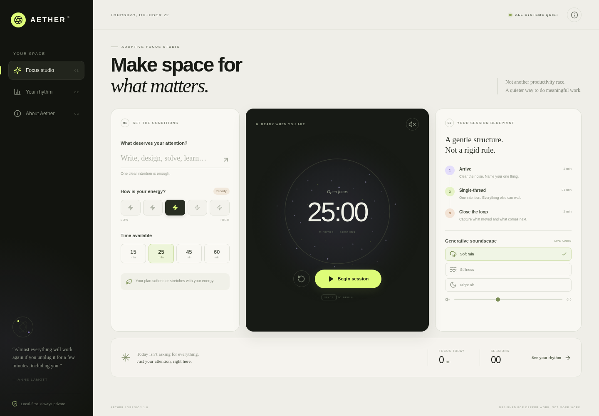

# Aether — Adaptive Focus Studio

**A quieter way to do meaningful work.**

Aether is a polished, privacy-first focus workspace that adapts each session to your available time and current energy. It combines an intelligent session blueprint, live generative soundscapes, an interactive focus visualization, and local-only progress insights.

No accounts. No API keys. No tracking. No backend.



## Why Aether is different

Most focus timers ask you to fit the tool. Aether adapts the tool to you.

- **Energy-aware planning** — low-energy sessions get a softer start; high-energy sessions make more room for flow. Every plan divides your exact available time into arrival, focus, and reflection phases.
- **Generative audio, not audio files** — soft rain, harmonic stillness, and night air are synthesized in real time with the Web Audio API.
- **Interactive ambient visualization** — a responsive canvas aura reacts to session state, energy, and pointer movement while respecting reduced-motion preferences.
- **Accurate focus timer** — timestamp-based timing stays correct when the browser tab is backgrounded.
- **Local progress insights** — seven-day rhythm chart, session history, current streak, energy patterns, and CSV export.
- **Offline-ready PWA** — production builds install a service worker and can be launched as a standalone app.
- **Private by architecture** — intentions and history never leave `localStorage`. There are no analytics or third-party requests.
- **Thoughtful UX** — responsive layouts, accessible controls, keyboard shortcuts, and reduced-motion suport.

## Quick start

Requirements: **Node.js 20+** and npm.

```bash
npm install
npm run dev
```

Open the local URL printed by Vite. To create a production build:

```bash
npm run build
npm run preview
```

## Useful commands

| Command | What it does |
| --- | --- |
| `npm run dev` | Start the development server |
| `npm run build` | Type-check and build for production |
| `npm run preview` | Preview the production build |
| `npm test` | Run the unit test suite |
| `npm run test:watch` | Run tests in watch mode |

## How it works

### Adaptive blueprint

The planner in `src/lib/planner.ts` uses session length and a five-point energy check-in to allocate warm-up and reflection time. The algorithm is deterministic, transparent, and covered by unit tests—no opaque AI or external inference service.

### Generative sound

`src/lib/audio.ts` builds a small audio graph for each soundscape:

- **Soft rain:** filtered white noise layered with a brown-noise body.
- **Stillness:** slowly modulated harmonic sine waves.
- **Night air:** low-passed brown noise with a quiet low-frequency pad.

Browsers require a user gesture before audio can start, so sound begins when you start a session or explicitly enable it.

### Your data

Session history, sound preference, and your current intention are stored only in your browser. Use **Your rhythm → Export CSV** to take your data anywhere. Clearing browser storage removes it permanently. The “Add sample week” button exists only to make the insights interface easy to explore.

## Keyboard shortcuts

| Key | Action |
| --- | --- |
| `Space` | Begin / pause the current session |
| `R` | Reset the timer |

Shortcuts pause while you are typing in a form field.

## Tech stack

- React 18
- TypeScript (strict mode)
- Vite 6
- Web Audio API
- Canvas 2D + ResizeObserver
- Lucide icons
- Vitest
- Native CSS, localStorage, and Service Worker APIs

## Project structure

```text
aether-focus/
├── .github/workflows/ci.yml   # GitHub Actions build + tests
├── public/                    # PWA manifest, icon, service worker
├── src/
│   ├── components/            # Generative canvas visualization
│   ├── hooks/                 # Safe localStorage state
│   ├── lib/                   # Audio engine, planner, tests
│   ├── App.tsx                # Studio, insights, and about views
│   ├── main.tsx               # Application entry point
│   ├── styles.css             # Responsive design system
│   └── types.ts               # Shared domain types
├── index.html
├── package.json
├── tsconfig.json
└── vite.config.ts
```

## Deploy

Aether is a static site and works on Netlify, Vercel, Cloudflare Pages, or any static web host.

- **Build command:** `npm run build`
- **Output directory:** `dist`
- **Install command:** `npm install`

For GitHub Pages project sites, set Vite's `base` option to `/<repository-name>/` before building. The included service worker currently assumes deployment at the domain root.

## Upload to GitHub

```bash
git init
git add .
git commit -m "feat: launch Aether adaptive focus studio"
git branch -M main
git remote add origin https://github.com/YOUR_USERNAME/aether-focus.git
git push -u origin main
```

Replace `YOUR_USERNAME` with your GitHub username. The ZIP intentionally excludes `node_modules` and build output; GitHub Actions installs dependencies and validates every push.

## Browser support

Current versions of Chrome, Edge, Firefox, and Safari. Audio requires Web Audio support. If audio cannot initialize, the timer and all other features continue to work.

## Contributing

See [CONTRIBUTING.md](CONTRIBUTING.md). Ideas and thoughtful improvements are welcome.

## License

Released under the [MIT License](LICENSE). Use it, learn from it, and make it your own.
